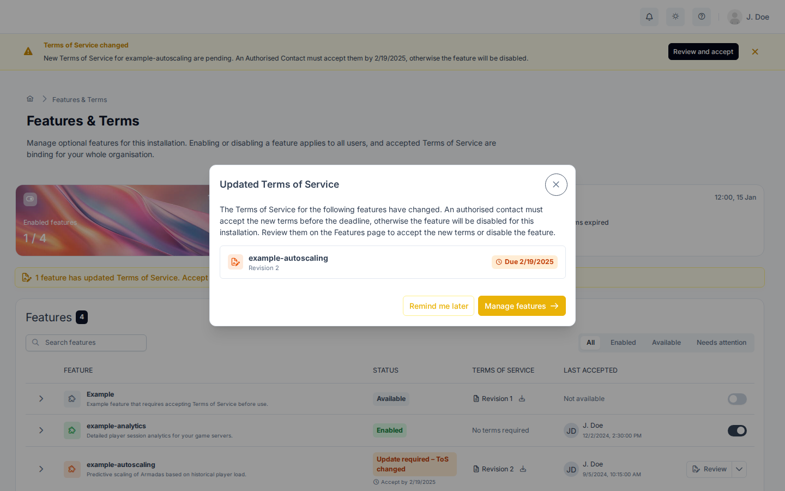

# Features

Features are gated capabilities in GameFabric.
New capabilities often start as features that must be enabled before anyone can use them.
As a capability matures, it becomes generally available and no longer needs to be enabled, and it leaves the Features page.

Enabling or disabling a feature is done by an [authorized contact](#authorized-contacts) from your company and applies to all users of the installation.

## Authorized contacts

An authorized contact is a person at your company who is allowed to manage features on behalf of your organization. Authorized contacts can enable and disable features. If you aren't an authorized contact, ask one at your company or your Customer Success Manager.

Every installation includes the `default:authorized-contacts` group. To make a user an authorized contact, add them to this group. To remove them, unassign them from the group. See [Editing Permissions](/multiplayer-servers/authentication/editing-permissions) for how to assign users to groups.

## View features

Features appear in the **Admin Area** section of the navigation. The entry is visible to authorized contacts. See [Authorized contacts](#authorized-contacts).

If the entry doesn't appear in the navigation, you either lack the permission to view features, or no features are currently available.

The page lists the features that are visible to you and shows whether each one is enabled. Authorized contacts use it to enable and disable features. Enabled features take effect automatically and immediately. To search or filter the list, use the controls above the table.

## Enable a feature

To enable a feature, you must be an authorized contact.

1. Open **Features** in the **Admin Area** section of the navigation.
1. In the row of the feature, turn on the toggle. The activation screen opens.
1. Review the impact of enabling the feature.
1. Select **Activate feature**.

## Disable a feature

To disable a feature, you must be an authorized contact.

1. Open **Features** in the **Admin Area** section of the navigation.
1. In the row of the feature, turn off the toggle. A confirmation dialog opens.
1. Review the impact of disabling the feature.
1. Select **Disable feature**.

Disabling a feature affects all users of the installation. You can enable the feature again at any time.
