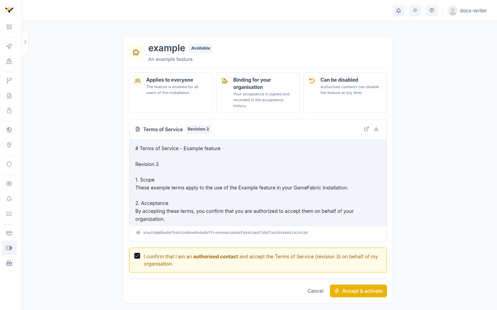

# Features

Features are gated capabilities in GameFabric.
New capabilities often start as features that must be enabled before anyone can use them.
As a capability matures, it becomes generally available and no longer needs to be enabled, and it leaves the Features page.

Enabling or disabling a feature is done by an [authorized contact](#authorized-contacts) from your company and applies to all users of the installation.
Some features come with [Terms of Service](#enable-a-feature-with-terms-of-service).

## Authorized contacts

An authorized contact is a person at your company who is allowed to manage features on behalf of your organization. Authorized contacts can enable features, disable features, and accept Terms of Service. If you aren't an authorized contact, ask one at your company or your Customer Success Manager.

Every installation includes the `default:authorized-contacts` group. To make a user an authorized contact, add them to this group. To remove them, unassign them from the group. See [Editing Permissions](/multiplayer-servers/authentication/editing-permissions) for how to assign users to groups.

## View features

Features appear in the **Admin Area** section of the navigation, as **Features & Terms**. The entry is visible to authorized contacts. See [Authorized contacts](#authorized-contacts).

If the entry doesn't appear in the navigation, you either lack the permission to view features, or no features are currently available to your installation.

The page lists the features that are visible to you and shows whether each one is enabled. Authorized contacts use it to enable and disable features. Enabled features take effect automatically and immediately. To search or filter the list, use the controls above the table.

## Enable a feature

To enable a feature that has no Terms of Service, you must be an authorized contact.
GameFabric decides whether a feature requires Terms of Service.

1. Open **Features & Terms** in the **Admin Area** section of the navigation.
1. In the row of the feature, turn on the toggle. The activation screen opens.
1. Review the impact of enabling the feature.
1. Select **Activate feature**.

## Enable a feature with Terms of Service

Some features come with Terms of Service. Accepting them is binding for your whole organization, and your acceptance is signed and recorded. 
To enable such a feature, you must be an authorized contact. Your Customer Success Manager can't enable such a feature or accept its terms on your behalf.

1. Open **Features & Terms** in the **Admin Area** section of the navigation.
1. In the row of the feature, turn on the toggle. The activation screen opens.
1. Review the impact of enabling the feature.
1. Review the Terms of Service. If your browser can display the document, GameFabric shows it on the activation screen. Otherwise, download the document and review it in a suitable application.
1. Select the checkbox to confirm that you are an authorized contact and accept the terms on behalf of your organization.
1. Select **Accept & activate**.

::: warning Browser requirement
GameFabric digitally signs your acceptance of the Terms of Service in your browser, using the Ed25519 algorithm of the Web Crypto API. A one-time key pair is generated for each acceptance. If your browser doesn't support Ed25519, GameFabric shows a warning and disables **Accept & activate**. Switch to a recent version of your browser.
:::

When GameFabric publishes a new revision of the Terms of Service for an enabled feature, an authorized contact must accept it again. To do so, select **Review** in the row of the feature and follow the steps from reviewing the Terms of Service. The time to accept is 6 weeks by default, but it can differ between Terms of Service. The feature keeps working during this time. If the time expires without acceptance, GameFabric pauses the feature until an authorized contact accepts the new revision.

To see who accepted which revision of the Terms of Service, expand a feature row. The history lists each revision with the date, and the name and ID of the user who accepted it.

## Disable a feature

To disable a feature, you must be an authorized contact.

1. Open **Features & Terms** in the **Admin Area** section of the navigation.
1. In the row of the feature, turn off the toggle. A confirmation dialog opens.
1. Review the impact of disabling the feature.
1. Select **Disable feature**.

Disabling a feature affects all users of the installation. You can enable the feature again at any time.
