# Managing Token Services

This page describes how to create, edit, and delete Token Services through GameFabric.

## Accessing Token Services

Navigate to **SteelShield™ → Token Services** in the left sidebar to open the Token Services list:

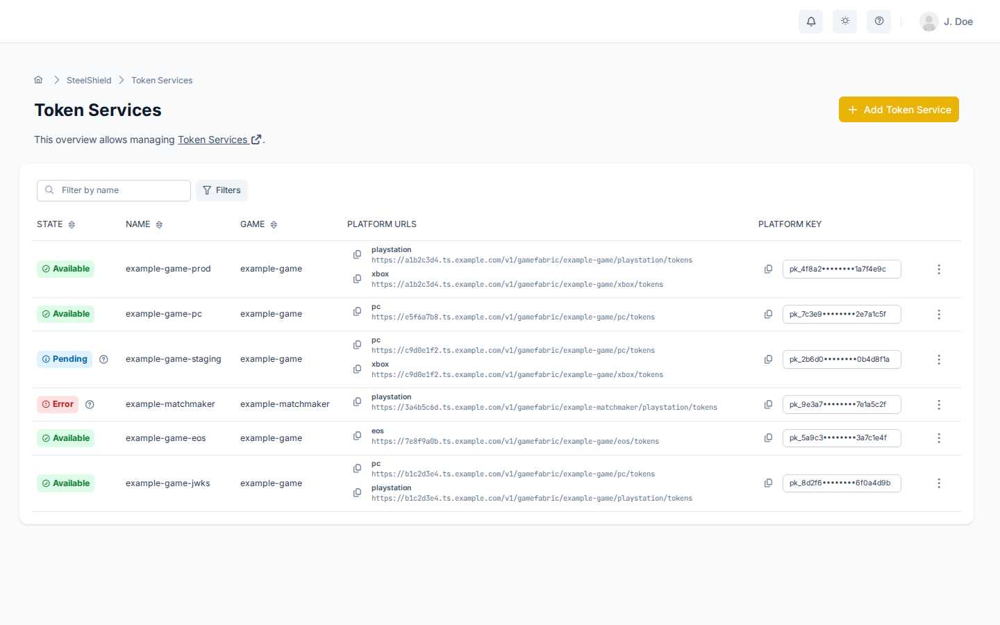

The list shows every Token Service with its name, game, current **state**, **platform URLs** for each enabled platform, and the **platform key** needed to authenticate with them.
If the state has a **reason**, hover over the question mark icon next to it to read the reason.

### Status

Each Token Service has a status that reflects its current state:

- **Pending**: the Token Service is being provisioned or updated.
- **Available**: the Token Service is ready to accept requests.
- **Error**: the Token Service encountered an error. GameFabric displays an error reason alongside the status.

When a Token Service is available, the Token Services list shows its platform URLs and platform key for authenticating requests.

## Adding a Token Service

To add a new Token Service, click **Add Token Service** on the Token Services page. The wizard consists of up to four steps:

1. **General**: name, environment, game identifier, and platforms.
2. **JWT Auth**: choose an authentication method and configure it.
3. **2nd JWT**: optionally add a secondary key. This step only appears for Custom Keys and Generated Keys.
4. **Confirm**: review the configuration.

### General settings

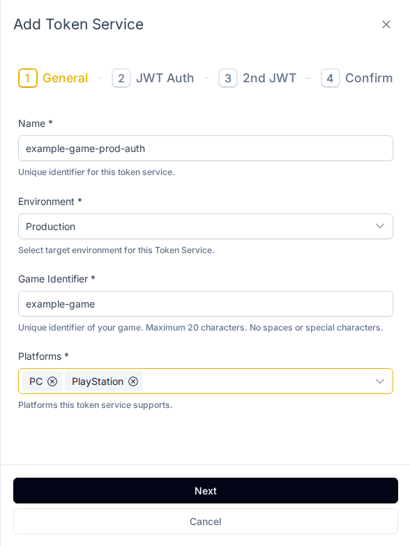
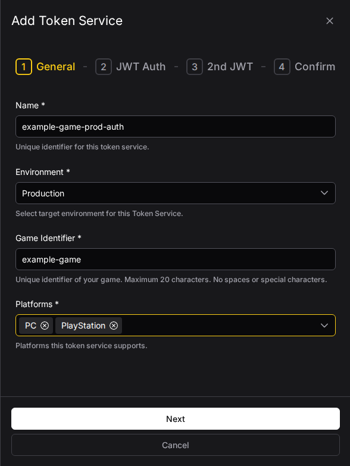

The General tab collects the basic configuration for the Token Service.

#### Environment

The **Environment** determines how the Token Service handles errors.
For a faulty request, the *Development* setting makes the Token Service return an [error response](/steelshield/token-service/api-reference#error-responses) that is relevant for developers.
For *Production*, the Token Service masks its behavior by always responding with success and a SteelShield token that does not function.

### Authentication settings

The JWT Auth tab lets you choose an authentication method and configure it per platform.

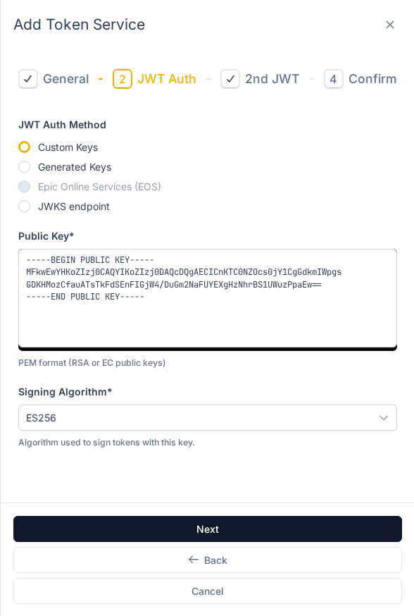
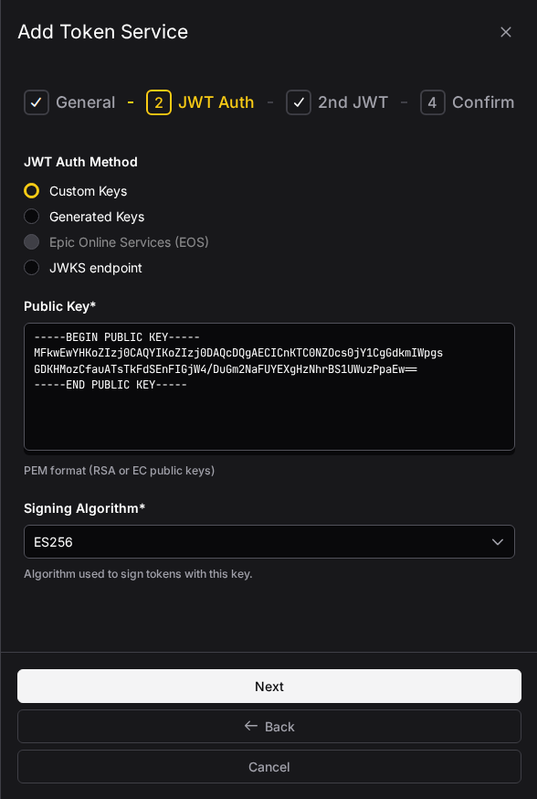

Choose one of the following authentication methods:

- [Custom Keys](#custom-keys): provide your own PEM public keys.
  - [Generated Keys](#generated-keys): generate the key pair in the browser instead of providing your own.
- [EOS (Epic Online Services)](#eos-epic-online-services): validate Epic Online Services tokens.
- [JWKS (JSON Web Key Set)](#jwks): use a remote JWKS endpoint.

See [Authentication Types](/steelshield/token-service/authentication-types) for full details.

#### Custom Keys

Paste a PEM public key and select the signing algorithm that matches the key type.
For example, use ES256 for a P-256 EC key and RS256 for an RSA key.
Supported algorithms are RS256, RS384, RS512, ES256, ES384, and ES512.

##### Generated Keys

Instead of providing your own key, you can generate an ES256 key pair in the web interface.

::: warning
The private key never reaches GameFabric's backend. It is shown only once and cannot be retrieved later.
Save it securely before closing the dialog.
Do not include it with the game client. It is meant only for signing by the authentication backend.
:::

#### EOS (Epic Online Services)

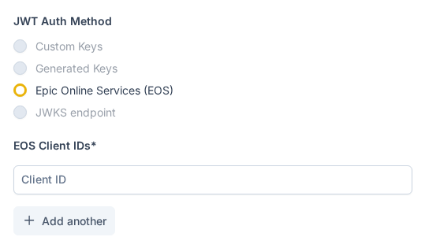
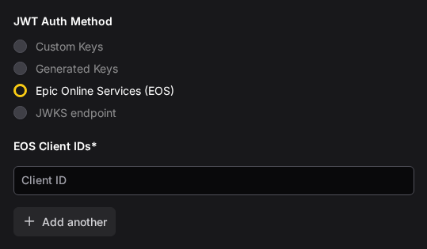

To use EOS authentication, select **EOS** as the only platform in the **Platforms** list in the **General** tab. In the API, skip the platforms list.

Enter one or more Epic Online Services client IDs.
Select **Add another** to add more client IDs.
The Token Service allows clients to authenticate with any of the client IDs you configure here.

#### JWKS

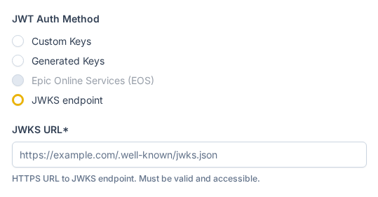
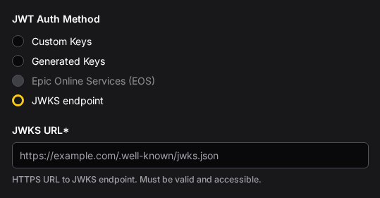

Provide an HTTPS URL to a JSON Web Key Set endpoint. The URL may look similar to `https://<hostname>/.well-known/jwks.json`, but it does not have to follow this format.

The Token Service regularly fetches the public keys from this endpoint to verify tokens.

### Secondary key

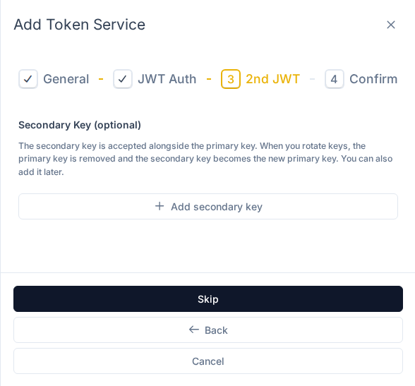
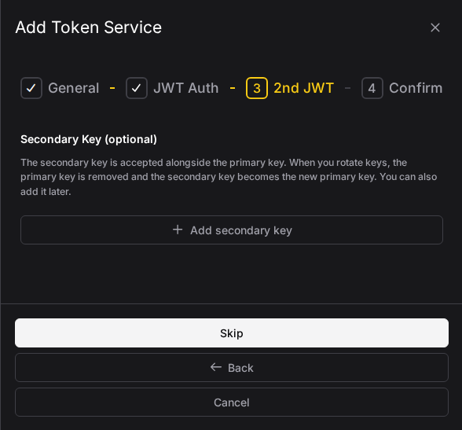

The optional **2nd JWT** step adds a secondary key next to the primary key, which is how you prepare a later rotation.
See [Rotating the key](#rotating-the-key).

To continue without one, click **Skip**.

### Confirm

Review the configuration and click **Create Token Service**.
After creation, the Token Service enters the **Pending** state while being provisioned.
GameFabric then assigns it a hostname and platform keys, which appear in the Token Services list.
When provisioning completes, the status switches to **Available**.

## Editing a Token Service

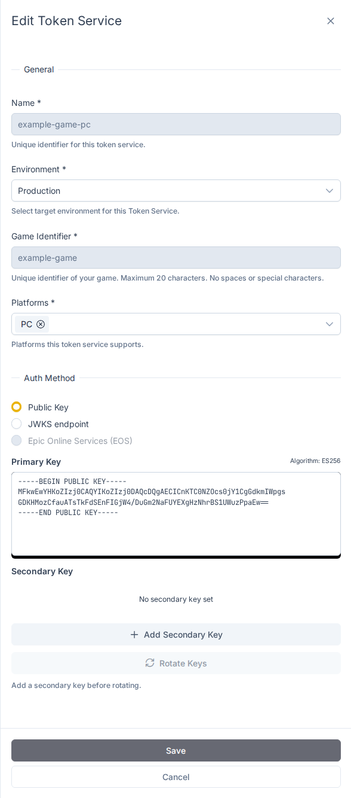
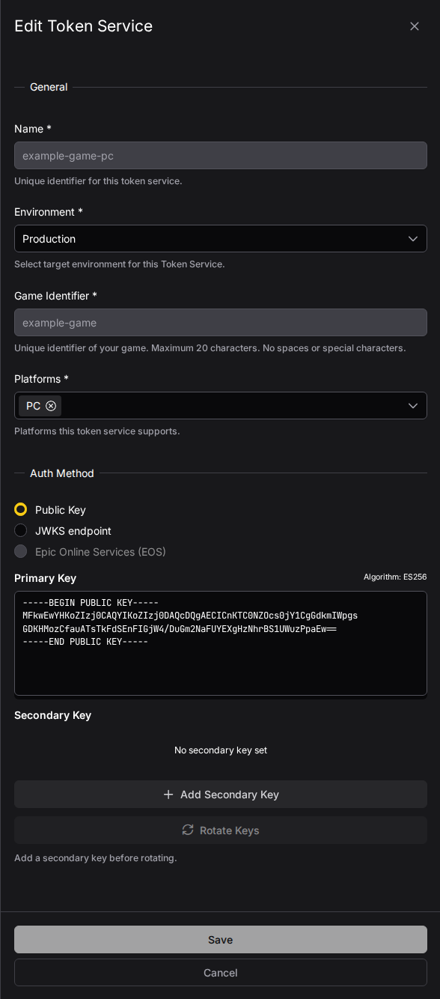

To edit an existing Token Service, click the ellipsis button (`⋮`) on the row and select **Edit**. A drawer opens pre-filled with the current configuration. Make your changes and click **Save**.

### Rotating the key

The Token Service can hold a primary key and an optional secondary key.
It accepts tokens signed with either key.
For Token Services that use **Custom Keys** or **Generated Keys**, the **Public Key** option in the **Auth Method** section of the edit drawer lists both keys.

The Auth Method section offers two actions:

- **Add Secondary Key**: adds a key next to the primary key. It is available only while no secondary key exists.
- **Rotate Keys**: removes the primary key and promotes the secondary key in its place. It is disabled until a secondary key exists.

Each key selects its own signing algorithm, so a rotation can also change the algorithm.
Adding a key does not invalidate any existing key.

To rotate the key without downtime, add the new key next to the old one, move your authentication backend to the new key, and then remove the old key.

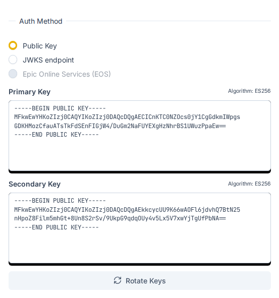

::: warning
Removing the primary key invalidates it **immediately**.
Before you remove it, make sure that your authentication backend signs tokens with the secondary key.
Game clients that still hold tokens signed with the removed key must request a new token from your backend to authenticate again.
:::

To rotate the key:

1. Check the **Secondary Key** field in the **Auth Method** section of the edit drawer.
   If it shows **No secondary key set**, continue with step 2.
   If a secondary key already exists, use it as the new key and skip to step 6.
   Confirm that your authentication backend holds that key's private key.
1. Prepare the new key. Create a key pair and keep the private key in your authentication backend's secret store, or let GameFabric generate a pair in a later step.
1. In the **Auth Method** section of the edit drawer, click **Add Secondary Key**.
1. Choose how to provide the new key:
   - **New custom key**: paste the new PEM public key or upload a PEM file, select its signing algorithm, and click **Save** in the panel.
   - **Generate new pair**: save the private key that GameFabric shows, and click **Done**.

   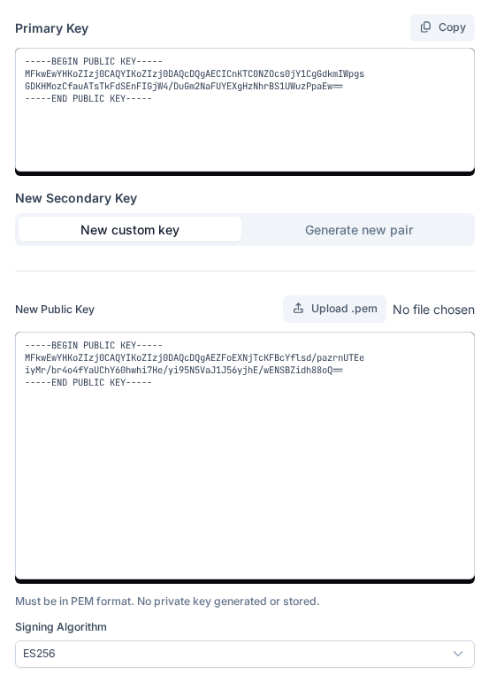

   ::: warning
   GameFabric shows the private key only once.
   Save it before you close the panel.
   :::

1. Click **Save** in the edit drawer. The Token Service shows **Pending** while GameFabric applies the change. Wait until it shows **Available**.
1. Update your authentication backend to sign tokens with the new private key. Tokens signed with the old key keep working.
1. Wait until no game client sends tokens signed with the old key. Allow at least the longest validity period that your backend sets for tokens signed with the old key (the `exp` claim).
1. Open the edit drawer again and click **Rotate Keys**. The panel shows the primary key that GameFabric removes and the secondary key that becomes the primary key.

   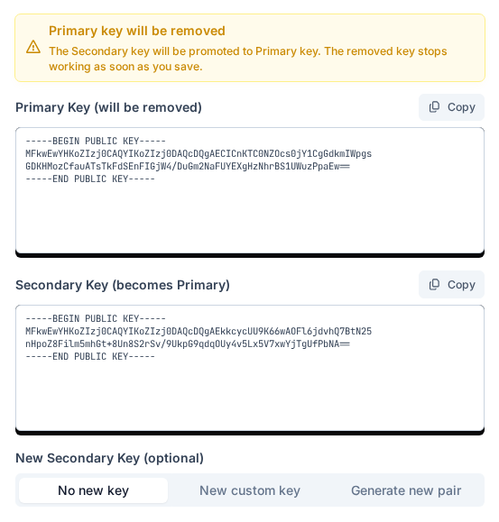

1. In the panel, choose **New custom key** or **Generate new pair** to prepare the next rotation, or keep **No new key** selected.
   Provide the new secondary key as before if you chose one.
   Then click **Save** in the panel, or **Done** after **Generate new pair**.
1. Click **Save** in the edit drawer. The **Confirm Key Rotation** dialog opens.
   Type the exact name of the Token Service.
   Then click **Confirm change**.

   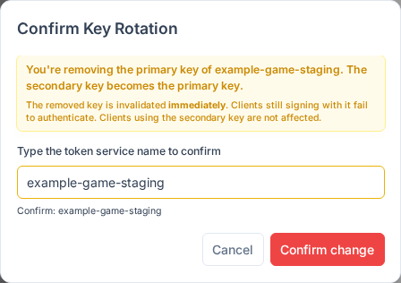

The Token Service shows **Pending** again while GameFabric applies the change. Afterwards, the former secondary key is the primary key.

## Deleting a Token Service

To delete an existing Token Service, click the ellipsis button (`⋮`) on the row and select **Delete**. The interface asks for confirmation once before deleting the Token Service.
